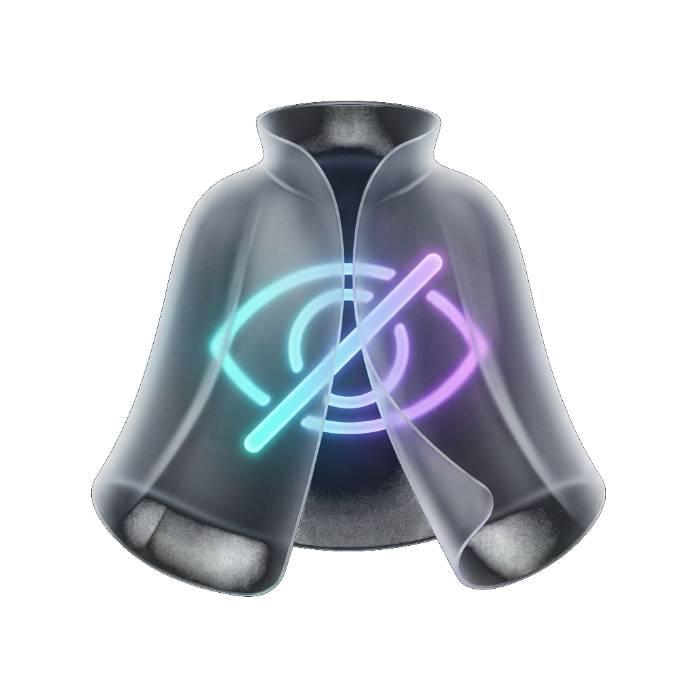

<div align="center">
  
  <h1>LaunchCloak</h1>
  <p><strong>专为 macOS 设计的轻量级启动台图标隐藏与恢复状态栏工具</strong></p>
  <p>A lightweight, elegant macOS menu bar app to seamlessly hide and restore Launchpad application icons.</p>

  <p>
    <a href="https://github.com/a916791360/LaunchCloak/releases"></a>
    
    
    <a href="LICENSE"></a>
  </p>
</div>

---

## 💡 为什么需要 LaunchCloak？

在 macOS（尤其是 macOS 26+）中，启动台（Launchpad）与“应用程序”浮窗默认扫描全盘所有软件。这导致：
- 经常使用的后台驻留小工具、CLI 包装程序、开发调试器塞满了启动台；
- 个人隐私或敏感应用无法在启动台中单独隐藏；
- 整个应用视图臃肿杂乱，缺乏原生级的收纳与隐藏管理。

**LaunchCloak** 以一种极其优雅且原生化的方式解决了这个问题 —— **不魔改系统核心代码，不破坏系统签名与完整性保护 (SIP)**，仅通过状态栏轻巧操作，即可实现应用图标的**真·一键隐藏与无损原路还原**。

---

## 🎨 图标设计理念 (Icon Design)

应用图标采用纯净的 **3D 半透明毛玻璃隐身斗篷**，内部包裹闪耀的 **荧光青紫闭眼微标**：
- 遵循 macOS 原生 **Soft（Liquid / SF）** 视觉标准；
- 去除多余的嵌套底框与双重圆角，以纯净通透的 3D 悬浮形态呈现，与 macOS 界面自然融为一体。

---

## 🛡️ 核心原理 (How It Works)

- **底层安全隔离**：隐藏应用时，将其安全移入用户个人专属的隔离目录 `~/.hidden_apps.noindex/`。
- **Spotlight 忽略特性**：macOS 聚焦与启动台索引机制默认会**彻底忽略**任何带有 `.noindex` 标识的目录，因此放入后图标即刻从启动台与搜索中消失。
- **零数据风险**：应用的所有用户数据、偏好设置和缓存（均位于 `~/Library/Application Support/`）完全不受任何影响。
- **精准原路恢复**：通过自动记录的 `metadata.json`，随时能将已隐藏的应用精准退回原安装路径（如 `/Applications`），恢复后启动台自动刷新呈现。

---

## ✨ 核心特性

- 🪶 **状态栏轻驻 (LSUIElement)**：无 Dock 栏图标占用，常驻于屏幕右上角，点击即用。
- 🫧 **macOS 原生 Soft 质感**：基于 SwiftUI 构建的毛玻璃透光材质、连续平滑圆角与触感微动效。
- 🔍 **全宽等分分段器**：“全部应用”与“已隐藏应用”横向舒展切换，支持中文拼音/英文实时模糊搜索。
- 🛡️ **智能保护与提权**：自动识别并标记系统核心受保护组件；遇到权限目录自动唤起原生系统授权。
- 📦 **一键全部恢复**：右上角“···”菜单提供一键全部恢复，随时一键复原所有启动台应用。

---

## 📥 下载与安装 (Download & Install)

### 方式一：直接下载预编译版本（推荐）

1. 进入 [GitHub Releases 页面](https://github.com/a916791360/LaunchCloak/releases)；
2. 下载最新版本（如 `LaunchCloak-v1.0.3-macos.zip`）并解压；
3. 将解压出的 `LaunchCloak.app` 拖入 `/Applications`（应用程序）文件夹；
4. 双击打开，图标常驻于屏幕右上角菜单栏（`eye.slash` 图标）。

> 💡 **初次打开提示“未知开发者”或“已损坏”？**  
> 这是 macOS Gatekeeper 对未购买苹果 99 美元/年商业开发者证书的开源 App 的常规拦截。在终端运行一次如下命令即可解除拦截：  
> ```bash
> xattr -cr /Applications/LaunchCloak.app
> ```

---

## 🛠️ 从源码构建 (Build from Source)

环境要求：macOS 14.0+，已安装 Xcode 或 Command Line Tools（包含 Swift 6+）。

```bash
# 1. 克隆仓库
git clone https://github.com/a916791360/LaunchCloak.git
cd LaunchCloak

# 2. 赋予脚本执行权限并一键编译打包
chmod +x build.sh
./build.sh

# 3. 编译并直接运行体验
./build.sh --run
```

---

## 📂 项目结构

```
LaunchCloak/
├── assets/
│   └── app-icon.png    # 高分辨率 App 图标资源
├── DESIGN.md           # Hallmark 交互白皮书与设计规范
├── README.md           # 项目开源说明与开发文档
├── LICENSE             # MIT 开源许可证
├── build.sh            # 自动化编译打包与签名脚本
├── AppIcon.icns        # 全尺寸 macOS 原生图标包
└── src/
    ├── Models.swift     # 核心数据模型 (AppItem, HiddenAppRecord)
    ├── AppManager.swift # 目录扫描、隔离隐藏与原路恢复引擎
    ├── Views.swift      # SwiftUI Soft 质感界面 (状态栏浮窗、分段器、搜索与卡片)
    └── main.swift       # 应用程序主入口 (MenuBarExtra)
```

---

## 📄 许可证

MIT License © 2026 qingmeng. 欢迎提出 [Issue](https://github.com/a916791360/LaunchCloak/issues) 与 [Pull Request](https://github.com/a916791360/LaunchCloak/pulls)！
